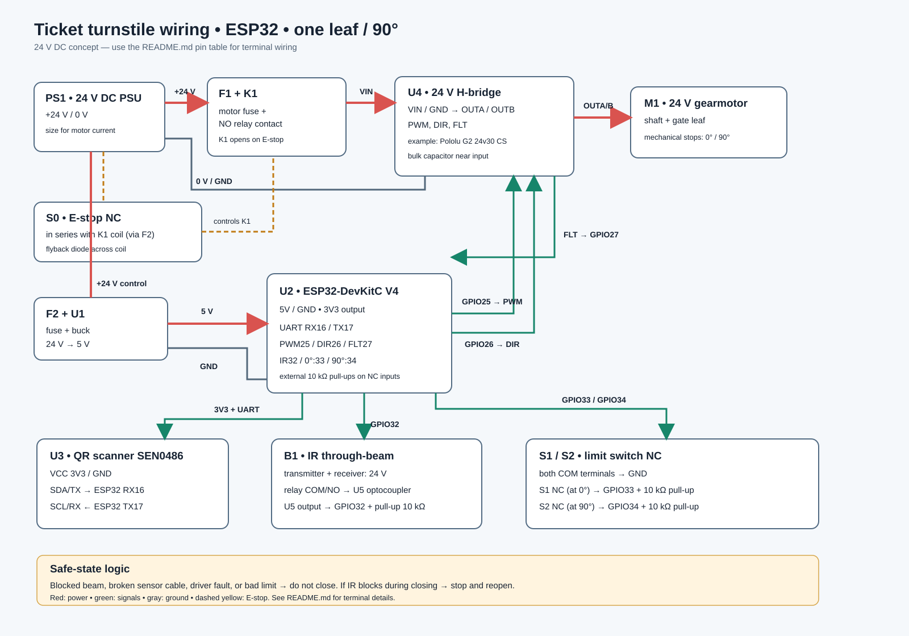

# Ticket turnstile gate wiring concept — one 90° swing leaf

Purchasing document: [Electrical bill of materials and component plan](./BOM-elektrikal.md).

KiCad schematic: [open the KiCad project](./kicad/turnstile-gate.kicad_pro) or [open the schematic directly](./kicad/turnstile-gate.kicad_sch). Read the [KiCad guide](./kicad/README.md) before using symbol pin numbers.

Control PCB: [layout](./kicad/control-board/control-board.kicad_pcb), [preview](./kicad/control-board/control-board-preview.svg), and [terminal guide](./kicad/control-board/README.md). This board carries 5 V/3.3 V signals; the 24 V power circuit and motor remain in the electrical panel.

Blender hardware model: [hardware.blend](./hardware.blend) and its [model and animation guide](./blender/README.md).

This is a **concept-level design for a full-size gate** using an ESP32-DevKitC V4 (ESP32-WROOM module), a 3.3 V UART QR scanner, a 24 V DC gearmotor, and an IR through beam pair. Select the motor and mechanism based on leaf weight, arm length, opening time, and motor stall current. The design is not a fabrication drawing or a safety certification. The Blender model currently shows a reflective IR module inside the upper beam; that placement does not yet match the through beam electrical design. Resolve the sensor choice and update both designs before fabrication.

## Main components

| Ref. | Component | Notes |
|---|---|---|
| PS1 | 24 V DC power supply | Size its current capacity for the motor and total load. Have a qualified electrician handle AC wiring and frame grounding. |
| F1 | Motor fuse | Size for the cable, driver, and motor current. |
| F2 | Control fuse | Size for the buck converter and control wiring. |
| S0, K1 | NC emergency stop + 24 V DC contactor/relay | S0 interrupts the K1 coil; the K1 NO contact disconnects the motor driver's `VIN`. Select DC-rated contacts for the motor current. Fit a flyback diode across the DC coil. Public installations require a safety circuit based on a risk assessment. |
| U1 | 24 V → 5 V buck converter | Powers the ESP32 through its `5V` pin; do not power it from USB at the same time. |
| U2 | ESP32-DevKitC V4 | Use the WROOM version so GPIO16/17 are available. |
| U3 | DFRobot SEN0486 QR scanner | Powered at 3.3 V; UART interface. |
| U4 | 24 V H-bridge driver | Example: Pololu G2 24v30 CS. Continuous and starting current, protection, cooling, and current limits must suit the motor. |
| M1 | 24 V DC gearmotor | The mechanism swings the leaf from 0° to 90°; provide mechanical stops at both ends. |
| B1 | IR through beam transmitter and receiver | The receiver needs a **voltage-free relay contact** that closes only when the path is clear **and the sensor is powered**. This generally means an energised relay when the beam is received, using `COM-NO`; check the chosen sensor's contact diagram. U5 isolates the contact from the ESP32. |
| U5 | PC817 optocoupler + 330 Ω resistor | Draws about 11 mA through B1's relay contact from 5 V and converts the result to a 3.3 V-safe GPIO32 signal. |
| S1, S2 | 0° and 90° limit switches | NC contacts that open at the respective end positions. |

## Electrical connections

| From | To | Purpose |
|---|---|---|
| PS1 `+24V` | F1 → K1 NO contact → U4 `VIN` | Motor power that the emergency stop can disconnect. |
| F2 output `+24V` | S0 NC → K1 coil → PS1 `0V` | Pressing S0 or breaking its cable releases K1. Fit a correctly polarised flyback diode across the coil. |
| PS1 `+24V` | F2 → U1 `IN+` and B1 supply `+` | Control and IR sensor power, subject to the sensor's rating. |
| PS1 `0V` | U4 `GND`; U1 `IN−`; B1 supply `−` | Supply return. Route motor current separately from signal wiring and join them at the distribution point. |
| U1 `5V+`, `5V−` | U2 `5V`, `GND` | ESP32 power. |
| U2 `3V3`, `GND` | U3 `VCC`, `GND` | Power the QR scanner at 3.3 V. |
| U3 `SDA/TX` | U2 `GPIO16` (UART RX) | Scan data. |
| U2 `GPIO17` (UART TX) | U3 `SCL/RX` | Optional scanner commands/configuration. |
| U2 `GPIO25` | U4 `PWM` | Motor speed. |
| U2 `GPIO26` | U4 `DIR` | Opening/closing direction; verify motor polarity during commissioning. |
| U2 `GND` | U4 `GND` | Driver signal reference. |
| U4 `OUTA`, `OUTB` | M1 terminals A, B | Two motor leads. |
| U4 `FLT` | U2 `GPIO27` + 10 kΩ pull-up to `3V3` | Active-low driver fault. |
| U1 `5V+` | 330 Ω / 0.5 W resistor → U5 LED anode; U5 LED cathode → B1 `COM`; B1 `NO` → U1 `5V−` | About (5 − 1.2)/330 = 11.5 mA through the relay contact when the path is clear. This meets the example Omron E3JK sensor's 5 V / 10 mA minimum load. Check U5 LED polarity. |
| U5 transistor collector, emitter | U2 `GPIO32` + 10 kΩ pull-up to `3V3`, U2 `GND` | `LOW` = clear path; `HIGH` = blocked path, unpowered sensor, or broken cable. Verify all three cases. |
| S1 `COM`, `NC` | U2 `GND`, `GPIO33` + 10 kΩ pull-up to `3V3` | `HIGH` = gate reaches 0° or the cable is broken. |
| S2 `COM`, `NC` | U2 `GND`, `GPIO34` + **external** 10 kΩ pull-up to `3V3` | `HIGH` = gate reaches 90° or the cable is broken. GPIO34 has no internal pull-up. |

Add an electrolytic capacitor close to the driver's `VIN`/`GND` as specified by its documentation (at least several hundred µF, with a voltage rating above 24 V). Do not power the ESP32 from the motor driver's `3V3 (out)` pin. Mount U5 on a protected, rigid PCB or perfboard inside the panel; do not use a breadboard for permanent installation.

## Control sequence

1. After a valid QR scan, check that S0 is inactive, the limit switches are consistent, the driver has no fault, and the IR path is clear.
2. Drive the motor open with a gentle PWM ramp until S2 indicates 90°. Stop on a timeout or fault.
3. Wait for a person to pass: the IR beam must first be interrupted and then become clear. After a safe delay, begin closing only if additional safety sensing confirms that the leaf's swing area is clear.
4. If the IR path is blocked while closing, **stop and reopen**. Stop at S1 (0°).
5. On a fault, loss of sensor power, or failure to reach a limit within the allowed time, disable the drive and request operator inspection. Never close solely on a timer.

Place the IR beam across the walking path, outside the leaf's swing area. A single beam can miss a child, luggage, or a person standing elsewhere. A public gate requires mechanical risk assessment, additional safety sensors, force/speed limits, and a manual release for power failures.

## Component references

- [Espressif ESP32-DevKitC V4: pinout and power rules](https://docs.espressif.com/projects/esp-idf/en/v5.3.1/esp32/hw-reference/esp32/get-started-devkitc.html)
- [DFRobot SEN0486: specifications, UART, and pinout](https://wiki.dfrobot.com/sen0486/)
- [Pololu G2 24v30 CS: pinout, electrical limits, and supply capacitor](https://www.pololu.com/product/5692)
