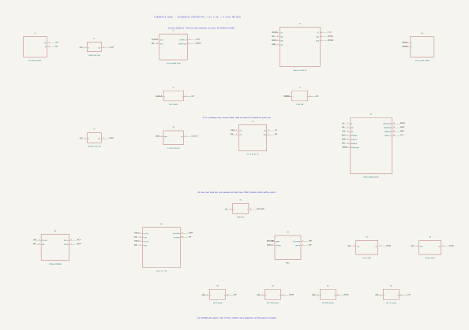

# Turnstile gate KiCad schematic

Main file: [turnstile-gate.kicad_sch](./turnstile-gate.kicad_sch). Open the [KiCad 10 project](./turnstile-gate.kicad_pro), then launch the Schematic Editor. Local symbols are in [Turnstile.kicad_sym](./Turnstile.kicad_sym) and registered through `sym-lib-table`.

An initial control PCB layout is available at [control-board/control-board.kicad_pcb](./control-board/control-board.kicad_pcb). Read its [terminal map and design limits](./control-board/README.md) before assembly. This system schematic also includes panel-mounted components that are not placed on the control PCB.

## Sheet contents

- J1: **24 V DC input from an external PSU**; the 230 V AC connection to the PSU is not shown.
- F1, K1, U4, M1: motor power path through the fuse and emergency-disconnect relay contact, followed by the H-bridge driver and DC gearmotor.
- F2, S0, U1, U2: 24 V control path, NC emergency stop, 5 V buck converter, and ESP32.
- U3: 3.3 V UART QR scanner.
- B1, R1, U5: 24 V IR sensor with a relay contact that closes only when the beam is clear and powered; the 330 Ω resistor drives about 11 mA through the PC817 LED.
- S1/S2, R2–R5: 0°/90° limit switches and 10 kΩ pull-ups for IR, both limits, and the driver fault signal.
- D1: K1 coil flyback diode; C1: bulk capacitor at the driver input.

**Pin numbers 1, 2, etc. on module symbols are logical schematic numbers, not physical product header numbers.** Use the pin names and the selected component's datasheet when preparing terminal or fabrication drawings. All project symbols represent circuits or modules and have no PCB footprints. This is a prototype schematic; K1 and the emergency-stop path do not constitute a certified safety system for a public gate.

## Validation results

- KiCad CLI **10.0.7** can read and export the file.
- [ERC report](./turnstile-gate-erc.txt): **0 violations**. All custom pins are passive, so this ERC checks symbol and connection integrity; it does not validate ratings or safety.
- [Netlist](./turnstile-gate.net): **21 components, 20 nets**; checked against the connections defined in the generator.

To regenerate from code, run `python generate_schematic.py`. Export the netlist from KiCad again, then run `python validate_netlist.py`. Motor selection, fuse/cable/relay ratings, IR placement, and manual release remain subject to the [component plan](../BOM-elektrikal.md). The Blender model currently depicts a reflective IR module, while this schematic specifies a through beam pair; reconcile the final sensor choice before fabrication.
